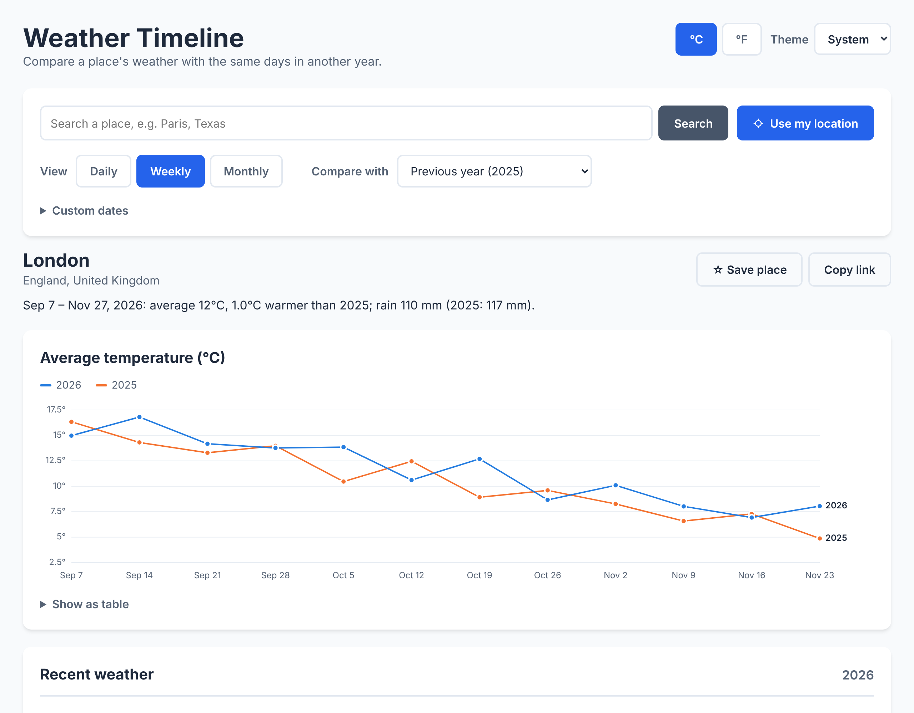

# Weather Timeline

[](https://github.com/ardacanbakis/claudeRepo/actions/workflows/ci.yml)

Compare a place's weather with the same days in another year: day by day, week by week or month by month. Was this autumn really warmer than last year's? Wetter than the 10-year average?

**Live demo:** https://ardacanbakis.github.io/claudeRepo/



<sub>Screenshot rendered with sample data. A dark theme is included ([screenshot](docs/screenshot-dark.png)).</sub>

## Features

- **Real historical data** from [Open-Meteo](https://open-meteo.com/). No API key and no sign-up.
- **Year-over-year comparison**: two aligned timelines that scroll together, so each column shows the same calendar days.
- **Compare against** the previous year, any year back to 1940, or a 10-year average.
- **Daily, weekly or monthly** views. Weeks are ISO weeks starting on Monday. Unfinished weeks and months are marked as partial and compared over the same days.
- **Difference badges** on every card (for example "▲ +2.1°C vs 2025") and a one-line summary of the whole period.
- **Line chart** of both years with a hover and keyboard crosshair, plus a data-table view.
- **High/low, rain and wind** on every card.
- **Custom date ranges** of up to two years.
- **Shareable links**: the place, view, dates and comparison live in the URL.
- **Saved places**, the last place viewed, °C/°F and a light/dark/system theme, all remembered on your device.
- **Accessible**: labelled controls, `aria-pressed` toggles, announced errors, visible focus and keyboard-operable chart. Works on phones.

## How the data works

| Period | Source | Notes |
|---|---|---|
| Older than 10 days | Open-Meteo [Historical Weather API](https://open-meteo.com/en/docs/historical-weather-api) (ERA5 reanalysis) | Consistent, gridded data back to 1940. Published with a delay of a few days. |
| Last 10 days and today | Open-Meteo [Forecast API](https://open-meteo.com/en/docs) (`past_days`) | Model data; may be revised slightly as the archive catches up. |
| Place search | Open-Meteo [Geocoding API](https://open-meteo.com/en/docs/geocoding-api) | Add a region or country to narrow it down: "Paris, Texas", "London, UK". |

The **daily average** used for differences and the chart is the midpoint of the day's high and low. This is the same for both sources, so comparisons stay consistent. Weekly and monthly cards show the average high and low, the total rain and the peak wind.

A typical load makes three requests: one place search, one archive request covering both years, and one forecast request. Switching views makes no requests, because the app downloads the widest window once and regroups it in the browser.

## Run it locally

You need [Node.js](https://nodejs.org/) 22 or newer.

```bash
npm install
```

```bash
npm run dev
```

Then open http://localhost:8080. The app is written in TypeScript and loads as ES modules, so it must be built and served over HTTP. Opening `index.html` directly from disk will not work.

| Script | What it does |
|---|---|
| `npm run dev` | Build, then serve the app at http://localhost:8080 (set `PORT` to change it) |
| `npm run build` | Compile TypeScript from `src/` and `test/` into `dist/` |
| `npm test` | Build and run the unit tests with Node's built-in test runner |
| `npm run lint` | ESLint with strict type-checked rules (no `any`) |
| `npm run typecheck` | `tsc --noEmit` with `strict` enabled |
| `npm run site` | Build the deployable site into `_site/` |

## Project structure

```
├── index.html            Page markup
├── styles.css            Styles, including the light and dark themes
├── src/
│   ├── main.ts           App controller: state, events, loading, rendering
│   ├── api.ts            Open-Meteo client: request planning, parsing, caching, place search
│   ├── aggregate.ts      Date windows, calendar buckets, comparisons and averages
│   ├── dates.ts          Time-zone-safe helpers for YYYY-MM-DD dates
│   ├── chart.ts          Dependency-free SVG line chart
│   ├── cards.ts          Timeline cards and the data table
│   ├── labels.ts         Text labels for cards and the chart
│   ├── state.ts          Shareable URL state and saved preferences
│   ├── units.ts          °C/°F, mm/in and km/h/mph formatting
│   ├── weather-codes.ts  WMO weather codes → labels and icons
│   └── types.ts          Shared types
├── test/                 Unit tests (node:test)
├── scripts/              Local dev server and site build
└── .github/workflows/    CI and GitHub Pages deployment
```

## Deployment

Every push to `main` runs lint, type checks and tests ([`ci.yml`](.github/workflows/ci.yml)), then deploys to GitHub Pages ([`pages.yml`](.github/workflows/pages.yml)).

One-time setup: in the repository on GitHub, open **Settings → Pages** and set **Source** to **GitHub Actions**.

## Privacy

- No accounts, no analytics and no server of our own. The browser talks to Open-Meteo directly.
- Your location is used only for the weather request and is never stored. Shared links contain the coordinates of the place you're viewing.
- Saved places and preferences stay in your browser's local storage.

## Troubleshooting

- **"No place called … was found"**: check the spelling, or add a country: "Springfield, Illinois".
- **"Location access was denied"**: allow location for the site in your browser settings. Geolocation also needs HTTPS or `localhost`.
- **"The weather service is limiting requests"**: Open-Meteo's free tier has fair-use limits. Wait a minute and try again.
- **Blank page when opening `index.html`**: run `npm run dev` instead, as described above.

## License

Code: [MIT](LICENSE). Weather data: © [Open-Meteo](https://open-meteo.com/), licensed under [CC BY 4.0](https://creativecommons.org/licenses/by/4.0/). Open-Meteo is free for non-commercial use.
